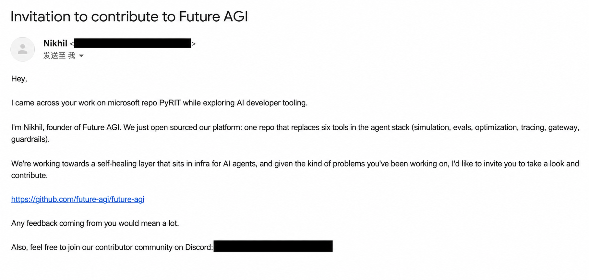
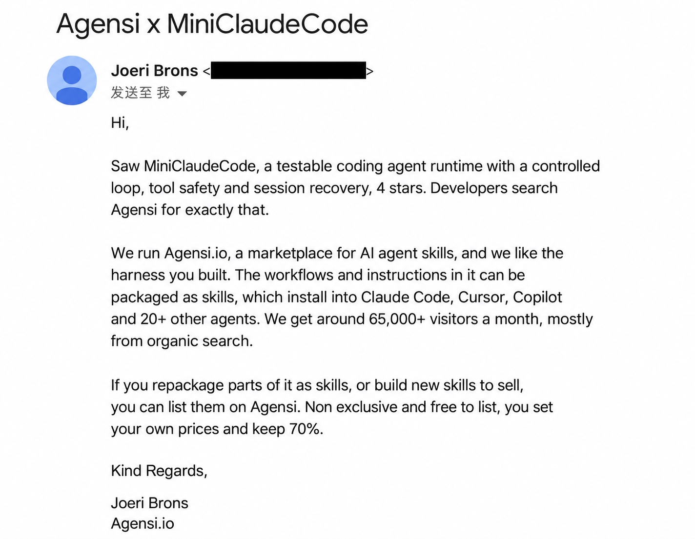

<!-- ============ Bloom Header ============ -->

<!-- ============ Open Source Contribution ============ -->

  🌱 
  微软 PyRIT 开源贡献者 ·
  <a href="https://github.com/microsoft/PyRIT/pull/2538">PR #2538 已合并 ↗</a>

<h3>🌍 开源交流</h3>
<b>Future AGI 开源贡献邀请</b> — 创始人 Nikhil 在了解我对 Microsoft PyRIT 的工作后，邀请我参与 Future AGI。

English &amp; 邮件截图

Future AGI founder Nikhil reached out after discovering my work on Microsoft PyRIT and invited me to explore and contribute to Future AGI.

<b>Agensi 平台入驻邀请</b> — 因 MiniClaudeCode 收到邀请，将项目工作流打包为技能并在平台上架。

English &amp; 邮件截图

Agensi reached out about MiniClaudeCode and invited me to package its workflows as skills for their marketplace.

<!-- ============ Sky ============ -->

  <picture>
    <source media="(prefers-color-scheme: dark)" srcset="sky-night.svg" />
    
  </picture>

<!-- ============ Tech Garden ============ -->

      

       

      

     

      

🌱 &nbsp;<b>Field guide</b> — open to read what every chip actually is

 

 
 
 
 
 

<!-- ============ Featured Work ============ -->

### Featured work

| Project | What to inspect |
|---|---|
| [MiniClaudeCode Studio](https://github.com/hey-Chloe/MiniClaudeCode-Studio) | Local agent runtime UI, checkpoint/resume flow, approval handling, and release validation notes. |
| [KAI Offline RecSys Lab](https://github.com/hey-Chloe/KAI-Offline-RecSys-Lab) | Offline recommendation-system experiments with deterministic metrics, retrieval baselines, and reproducible reports. |
| [ProofCut](https://github.com/hey-Chloe/proofcut) | Evidence-first content packaging pipeline with risk checks, local web demo, and publication manifests. |
| [AI research evidence](https://github.com/hey-Chloe/ai-research-evidence) | Source-led research notes and reproducibility ledger for AI project evidence. |
| [Portfolio site](https://github.com/hey-Chloe/hey-Chloe.github.io) | Published project index and visual portfolio source. |

<!-- ============ Stats ============ -->

<!-- ============ Footer (a cat lives here) ============ -->

  <picture>
    <source media="(prefers-color-scheme: dark)" srcset="garden-footer-night.svg" />
    
  </picture>

 
